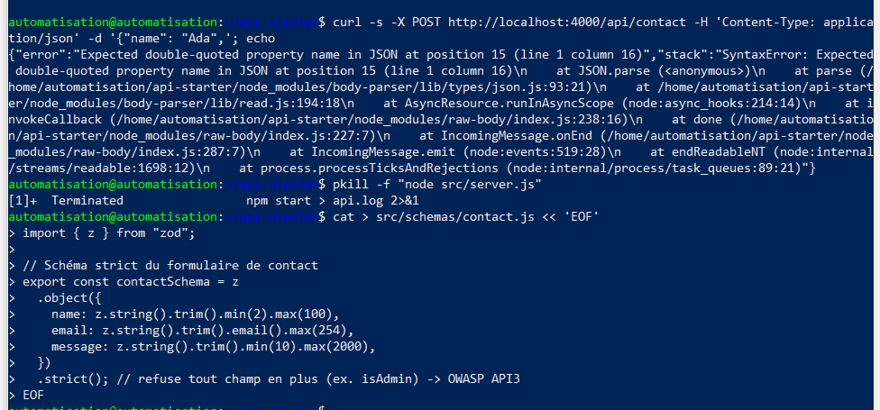
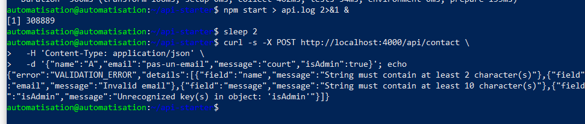
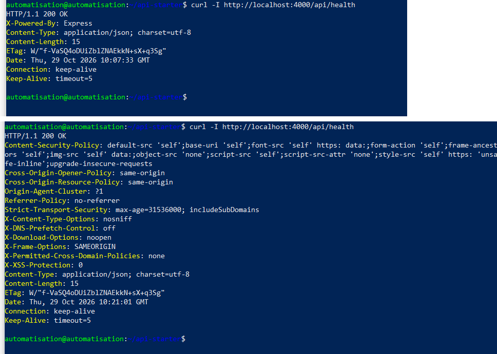
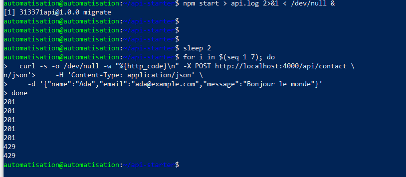
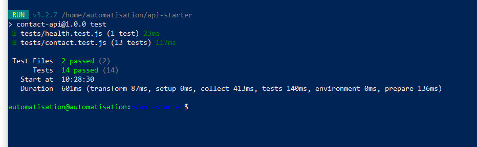
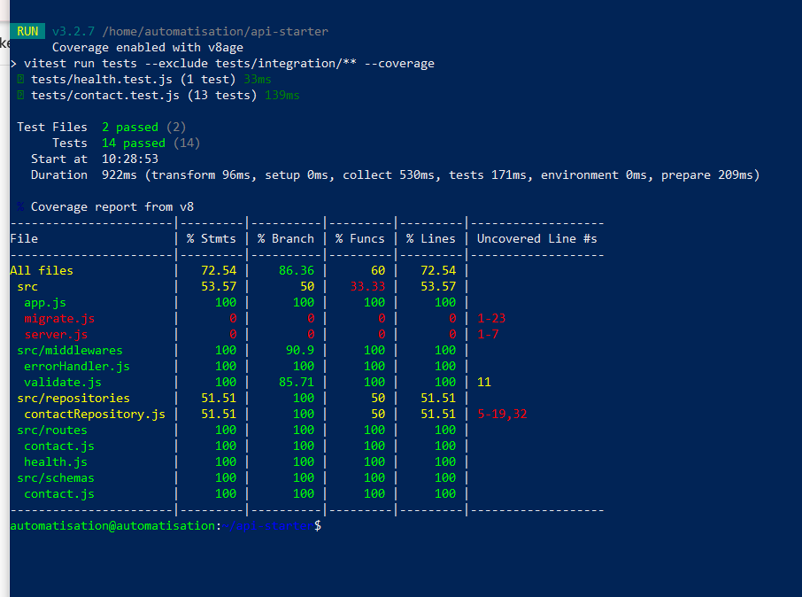
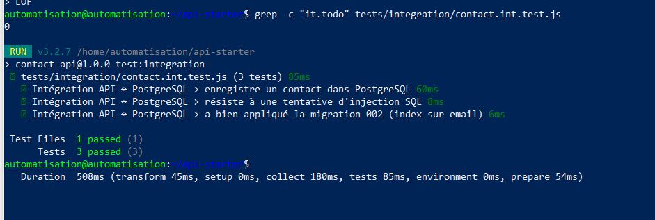
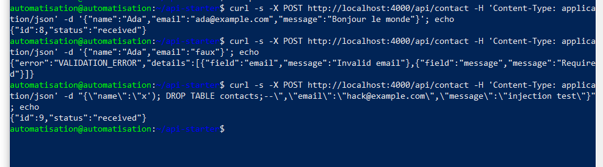

# TP8 — API Express sécurisée et testée

Zod, Helmet, rate limiting, Vitest, Supertest, PostgreSQL et migrations.

Une petite API de formulaire de contact (`POST /api/contact`), volontairement fragile au départ, rendue robuste puis couverte par des tests automatisés.

## Lancer le projet

```bash
npm install
cp .env.example .env              # puis changer PGPASSWORD
set -a; . ./.env; set +a
docker compose up -d --wait       # PostgreSQL 17
npm run migrate                   # applique migrations/*.sql (idempotent)
npm test                          # tests de routes (sans base)
npm run test:coverage             # couverture
npm run test:integration          # tests contre PostgreSQL
npm start                         # API sur http://localhost:4000
```

## Partie 1 — OWASP API Security Top 10 (2023)

| Risque OWASP | Concerne notre API ? | Mesure dans ce TP |
|---|---|---|
| API1 Broken Object Level Authorization | Non pour l'instant : aucune route ne lit un objet par son id. Oui dès qu'on ajoute `GET /api/contact/:id` | À prévoir : authentification + contrôle que l'utilisateur a le droit de lire cet objet |
| API2 Broken Authentication | Non : formulaire public, sans compte | Hors périmètre ; la route de lecture (défi) devrait être réservée à un administrateur authentifié |
| API3 Broken Object Property Level Authorization | **Oui** : un client pourrait envoyer `isAdmin: true` (mass assignment) | `.strict()` dans le schéma Zod refuse tout champ en trop, et la route ne transmet que `name`, `email`, `message` au repository |
| API4 Unrestricted Resource Consumption | **Oui** : rafales de requêtes, corps énormes | Rate limiting 5 req/min/IP sur `/api/contact`, corps JSON limité à 10 ko (413), longueurs max dans Zod |
| API5 Broken Function Level Authorization | Non : une seule fonction publique | À prévoir si une route d'administration est ajoutée |
| API6 Unrestricted Access to Sensitive Business Flows | **Oui** : spam du formulaire par des robots | Rate limiting (un CAPTCHA serait l'étape suivante) |
| API7 Server Side Request Forgery | Non : l'API n'appelle aucune URL fournie par le client | — |
| API8 Security Misconfiguration | **Oui** : stack trace renvoyée au client, `X-Powered-By: Express`, aucun header de sécurité | Helmet, `app.disable("x-powered-by")`, middleware d'erreur centralisé sans stack trace, 404 JSON |
| API9 Improper Inventory Management | Faible : une seule version de l'API | Routes documentées dans ce README |
| API10 Unsafe Consumption of APIs | Non : pas d'API tierce consommée | — |

**Injection SQL** (anciennement API8:2019) : les requêtes du repository sont **paramétrées** (`$1, $2, $3`), la valeur n'est jamais concaténée dans le SQL. Prouvé par un test unitaire et un test d'intégration.

### Trois attaques que la version de départ laissait passer

1. **Fuite d'informations** : un JSON tronqué (`{"name": "Ada",`) renvoyait une erreur 500 avec la **stack trace** complète (chemins des fichiers du serveur, versions des bibliothèques).
2. **Absence de validation / mass assignment** : un email invalide, un message vide, des types inattendus (`message: 42`) ou un champ `isAdmin: true` étaient transmis tels quels à la base.
3. **Consommation illimitée** : aucune limite de débit ni de taille, donc un robot pouvait envoyer des milliers de requêtes ou des corps énormes (spam, déni de service). En plus, `X-Powered-By: Express` révélait la technologie utilisée.

Version de départ : un JSON tronqué renvoie la stack trace au client.



## Partie 2 — Validation et gestion des erreurs

- `src/schemas/contact.js` : `name` (trim, 2–100), `email` (format email, ≤ 254), `message` (10–2000), `.strict()`.
- `src/middlewares/validate.js` : `safeParse`, réponse 400 `{ error: "VALIDATION_ERROR", details: [{ field, message }] }`, puis `req.body` remplacé par les données validées.
- `src/middlewares/errorHandler.js` : `INVALID_JSON` (400), `PAYLOAD_TOO_LARGE` (413), `INTERNAL_ERROR` (500). La stack trace est journalisée côté serveur (`console.error`), **jamais** envoyée au client.
- Route 404 JSON `{ "error": "NOT_FOUND" }` déclarée avant le middleware d'erreur.

Chaîne de middlewares : `helmet` → `express.json({ limit: "10kb" })` → rate limit → `validate(contactSchema)` → route → 404 → gestionnaire d'erreurs.



## Partie 3 — Durcissement HTTP

- `app.disable("x-powered-by")` et `app.use(helmet())` : ajout de `Content-Security-Policy`, `Strict-Transport-Security`, `X-Content-Type-Options: nosniff`, `X-Frame-Options: SAMEORIGIN`, `Referrer-Policy`, `Cross-Origin-*`.
- Corps JSON limité à 10 ko.
- `express-rate-limit` uniquement sur `/api/contact` : 5 requêtes par minute et par IP, headers standard `RateLimit-Policy: 5;w=60` et `RateLimit: limit=5, remaining=0, reset=32`, réponse `429 { "error": "TOO_MANY_REQUESTS" }`.
- Derrière un reverse proxy, il faudra activer `app.set("trust proxy", 1)`, sinon toutes les requêtes semblent venir de la même IP (celle du proxy).





## Partie 4 — Tests de routes et cas négatifs

14 tests (Vitest + Supertest, repository en mémoire, aucun port ouvert) :

- message valide (201) ;
- email invalide, champ manquant, champ en trop (`isAdmin`), types inattendus → 400 `VALIDATION_ERROR` ;
- JSON tronqué → 400 `INVALID_JSON` ;
- corps de plus de 10 ko → 413 `PAYLOAD_TOO_LARGE` ;
- nom contenant une injection SQL → stocké tel quel ;
- erreur 500 (repository qui lève une exception) → `{ "error": "INTERNAL_ERROR" }`, ni stack ni message d'origine, erreur bien journalisée ;
- headers Helmet présents, `x-powered-by` absent ;
- 6ᵉ requête → 429 ;
- route inconnue → 404 JSON.



**Couverture** : 100 % sur `app.js`, les middlewares, les routes et le schéma. `server.js`, `migrate.js` et la partie PostgreSQL du repository sont à 0–51 % car les tests de routes utilisent le repository en mémoire : ce code est couvert par les tests d'intégration.



## Partie 5 — PostgreSQL et migrations

- `npm run migrate` applique `001_create_contacts.sql` ; une 2ᵉ exécution n'applique rien (**idempotent**).
- Ajout de `002_add_contacts_email_index.sql` : `CREATE INDEX IF NOT EXISTS contacts_email_idx ON contacts (email);`
- `tests/integration/contact.int.test.js` (3 tests) :
  - un contact envoyé par l'API est retrouvé en base par une requête SQL ;
  - une injection SQL dans `name` est stockée telle quelle et la table `contacts` existe toujours ;
  - l'index de la migration 002 existe.



Tests manuels avec `curl` sur l'API démarrée : requête valide → `201 {"id":8}`, requête invalide → `400 VALIDATION_ERROR`, injection `x'); DROP TABLE contacts;--` → `201 {"id":9}`, la table est intacte.



## Adaptations à l'environnement

- Port 4000 déjà utilisé par un conteneur d'un autre TP : conteneur arrêté pendant le TP.
- Node.js 22 sur la VM (au lieu de 24) : aucun impact, tous les tests passent.
